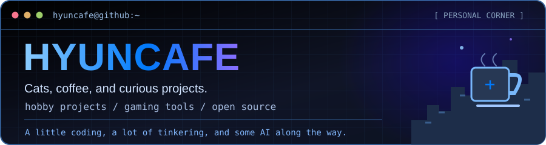
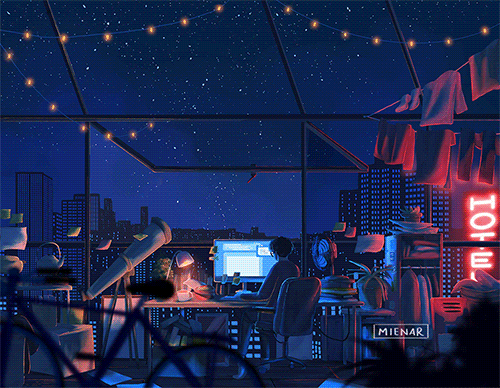
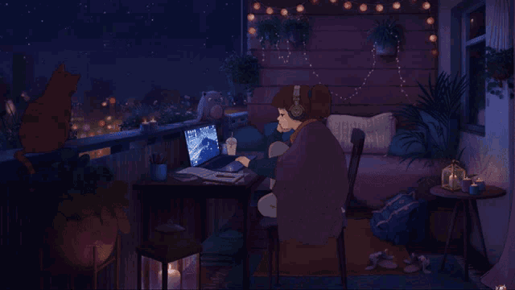
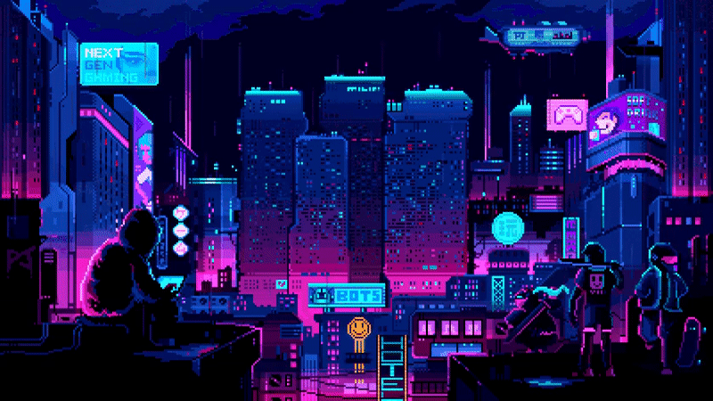
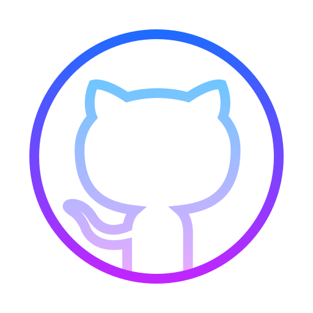
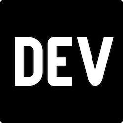

<!--
My README profile!
I've spent a lot of time putting this little corner of GitHub together.
If you like something here, feel free to take inspiration and make it your own!

This is my current introduction. My older projects are still here as part of
my learning journey, and the original artwork lives in assests/.
-->

  <picture>
    <source media="(max-width: 600px)" srcset="assests/profile-banner-mobile.svg" />
    
  </picture>

  <!-- The original live typing effect stays directly under the local banner. -->
  <picture>
    <source media="(max-width: 600px)" srcset="https://readme-typing-svg.demolab.com/?font=Operator%20Mono&amp;size=22&amp;duration=2800&amp;pause=1600&amp;color=0079FA&amp;background=0B1120&amp;center=true&amp;vCenter=true&amp;width=420&amp;height=56&amp;lines=Hey%2C%20I%27m%20Hyun%21%3BCats%2C%20coffee%20%26%20curious%20projects.%3BBuilding%20with%20AI%2C%20one%20idea%20at%20a%20time." />
  
  </picture>

  

  

    
    
    
  

  

    
    
  

<!-- Café menu hidden for now.

  
☕ <strong>Open the café menu</strong> — a little map of this corner

  

    <a href="#things-ive-been-working-on">🎮 Recent projects</a>
    &nbsp; · &nbsp;
    <a href="#a-little-of-my-coding-journey">💻 Coding journey</a>
    &nbsp; · &nbsp;
    <a href="#my-github-analytics--activity">📊 GitHub activity</a>
    &nbsp; · &nbsp;
    <a href="#connect-with-me">🌙 Say hello</a>
  

-->

<h2 align="center">
  Self-taught, curious, and  still building 
</h2>

Hey! I'm Hyun. I got into coding back in 2023 through [The Odin Project](https://www.theodinproject.com/), where I spent months learning HTML, CSS, and JavaScript and building projects from scratch. I learned a lot, had fun with it, and made this profile along the way.

These days, I'm more of a **hobbyist**. I haven't kept up with writing code from scratch, so I'm pretty rusty with syntax, but a lot of the fundamentals I learned have stuck with me, especially how to think through problems and understand how different parts of a system work together.

I use **AI as a coding partner** now, and it's changed how I approach projects. I'm more involved in the planning, problem-solving, and decision-making side of things while AI handles most of the actual implementation. I like breaking ideas into smaller pieces, thinking through requirements and dependencies, identifying potential issues, and refining the approach when something doesn't quite make sense. I'm also pretty particular about testing things, preserving what already works, and making sure the end result is actually useful. It's a lot of back-and-forth, experimenting, troubleshooting, and improving things as I go. I still enjoy coding and learning, just in a different way than when I first started.

* 🐾 **Around here:** Always happy to meet people, share ideas, and learn something new.
* ☕ **Interests:** Cats, coffee, anime/manga, gacha and other games, Discord, Reddit, and a good lo-fi playlist.

  

---

<h2 align="center">Things I've been working on</h2>

Most of my recent projects started with something I wanted to fix or make easier in my own setup. Here are a few that made it onto GitHub.

  <picture>
    <source media="(max-width: 600px)" srcset="assests/project-log-mobile.svg?v=311-controller-refresh" />
    
  </picture>

<table>
  <tr>
    <td width="50%" valign="top">
      <strong> <a href="https://github.com/HyunCafe/LocalGameImporter">Local Game Importer</a></strong>
      
A Playnite extension that finds local Windows game launchers and lets you review what to import.

      Playnite · AI-assisted
    </td>
    <td width="50%" valign="top">
      <strong> <a href="https://github.com/HyunCafe/DuplicateReview">Duplicate Review</a></strong>
      
Helps spot duplicate and similar game titles in Playnite, with manual review instead of automatic hiding.

      Library organization · AI-assisted
    </td>
  </tr>
  <tr>
    <td valign="top">
      <strong> <a href="https://github.com/HyunCafe/contribute-practice">Contribute Practice</a></strong>
      
A beginner-friendly way to practice Git Bash, VS Code, and your first pull request. Started in 2023 and refreshed in 2026.

      Open source · Beginner-friendly
    </td>
    <td valign="top">
      <strong> <a href="https://github.com/HyunCafe?tab=repositories">More tinkering</a></strong>
      
Older learning projects, little experiments, and whatever else I end up working on.

      Personal projects · Experiments
    </td>
  </tr>
</table>

  

<h2 align="center">A little of my coding journey</h2>

  <h3>My 2023 foundations</h3>

  

    
    
    
    
    
  

A few projects from those days:

* **[Calculator](https://github.com/HyunCafe/odin-calculator)** — JavaScript logic, UI design, and lots of debugging.
* **[To-do App](https://github.com/HyunCafe/odin-todoapp)** — Planning modules, organizing features, and working through how different parts of an app interact.
* **[Weather App](https://github.com/HyunCafe/odin-weatherapp)** — APIs, responsive design, and connecting data to an interface.
* **[JavaScript Notes](https://github.com/HyunCafe/my-javascript-notes)** — The notes and practice exercises I kept while learning.

  <h3>What I use these days</h3>

  

    
    
    
    
  

  Tools I use for hobby projects, not a claim of professional expertise.

  

---

  <h2>My GitHub Analytics &amp; Activity</h2>
  

  <!-- Five summary cards; language cards use weekly-refreshed local SVGs to align their segment colors with HyunCafe's theme. -->
  

    
  

  <!-- Natural line wrapping keeps paired cards readable on narrow screens. -->
  

    
    
  

  

    
    
  

  Language charts reflect project code, including AI-assisted projects. The hourly chart uses UTC.

  

  

  <h3>Connect With Me</h3>

  
  &nbsp;&nbsp;
  
  &nbsp;&nbsp;
  

  

    
  

  Thanks for stopping by! Feel free to look around, and if you like something here, take inspiration and make it your own.

