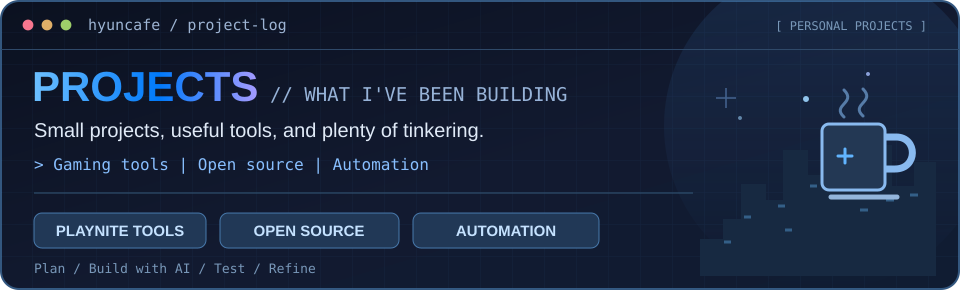

<!--
My README profile!
I've spent a lot of time putting this little corner of GitHub together.
If you like something here, feel free to take inspiration and make it your own!

This is my current introduction. My older projects are still here as part of
my learning journey, and the original artwork lives in assests/.
-->

  

  

  

    
  

<h2 align="center">
  Self-taught, curious, and  still building 
</h2>

Hey! I'm Hyun. I got into coding back in 2023 through [The Odin Project](https://www.theodinproject.com/), where I spent months learning HTML, CSS, and JavaScript and building projects from scratch. I learned a lot, had fun with it, and made this profile along the way.

These days, I'm more of a **hobbyist**. I haven't seriously practiced writing code on my own since those early projects, so I'm rusty with syntax and the little implementation details. What stuck with me is how to think through problems, break them into pieces, and figure out how everything fits together.

I use **AI as a coding partner** now. I bring the idea, work out what I want it to do, and help guide the structure, testing, troubleshooting, and revisions. AI does a lot of the actual implementation. I'm still learning as I go—just a little differently than I did in 2023.

* 🌳 **Then:** Learning web development, JavaScript, and how to build things step by step.
* 🛠️ **Now:** Tinkering with hobby projects, automations, and tools I actually want to use—with AI assistance.
* 🐾 **Around here:** Always happy to meet people, share ideas, and learn something new.
* ☕ **Interests:** Cats, coffee, anime/manga, gacha and other games, Discord, Reddit, and a good lo-fi playlist.

  

---

## Things I've been working on

Most of my recent projects start with something I want to fix, simplify, or automate. These are **AI-assisted projects**: I guide the idea and behavior, work through the results, and use AI to help write and improve the code.

  
  
  

<table>
  <tr>
    <td width="50%" valign="top">
      <h3>🎮 <a href="https://github.com/HyunCafe/LocalGameImporter">Local Game Importer</a></h3>
      
A Playnite extension to discover and import locally installed Windows games, with review controls instead of blindly adding everything.

      Gaming tools · AI-assisted project
    </td>
    <td width="50%" valign="top">
      <h3>🧩 <a href="https://github.com/HyunCafe/DuplicateReview">Duplicate Review</a></h3>
      
Another Playnite extension, this time for spotting duplicate and similar game titles without automatically hiding or deleting anything.

      Library organization · AI-assisted project
    </td>
  </tr>
  <tr>
    <td valign="top">
      <h3>☕ <a href="https://github.com/HyunCafe/contribute-practice">Contribute Practice</a></h3>
      
My beginner-friendly open-source practice project. Learn Git Bash, VS Code, and pull requests by making a real contribution. Started in 2023 and recently refreshed.

      Open source · Beginner-friendly
    </td>
    <td valign="top">
      <h3>🛠️ How I like to build</h3>
      
Start with a problem, work out the parts, build with AI, test the results, and keep refining until things actually work.

      Planning · Testing · Troubleshooting
    </td>
  </tr>
</table>

  

I'm interested in the whole process: understanding the problem, working out the structure, testing edge cases, fixing what breaks, and making the result easier for someone else to use.

## A little of my coding journey

  <h3>My 2023 foundations</h3>

  

I learned through hands-on exercises and small projects. I don't use all of these skills regularly anymore, but that foundation still helps me think through what I'm building today.

A few projects from those days:

* **[Calculator](https://github.com/HyunCafe/odin-calculator)** — JavaScript logic, UI design, and lots of debugging.
* **[To-do App](https://github.com/HyunCafe/odin-todoapp)** — Planning modules, organizing features, and working through how different parts of an app interact.
* **[Weather App](https://github.com/HyunCafe/odin-weatherapp)** — APIs, responsive design, and connecting data to an interface.
* **[JavaScript Notes](https://github.com/HyunCafe/my-javascript-notes)** — The notes and practice exercises I kept while learning.

  <h3>What I use these days</h3>

  <strong>Git Bash · GitHub · VS Code · PowerShell · AI-assisted coding · Testing & troubleshooting</strong>

Some of my newer projects use C# or Python with substantial AI help. That doesn't mean I'm independently proficient in those languages. My part is understanding what the tool should do, testing it, and working through the changes until it's useful.

  

---

  <h2>My GitHub Activity</h2>

  

  

    
  

  

    
  

  

    
  

  

  

  <h3>Connect With Me</h3>

  
  &nbsp;&nbsp;
  
  &nbsp;&nbsp;
  

  Thanks for stopping by! Feel free to look around, and if you like something here, take inspiration and make it your own.

